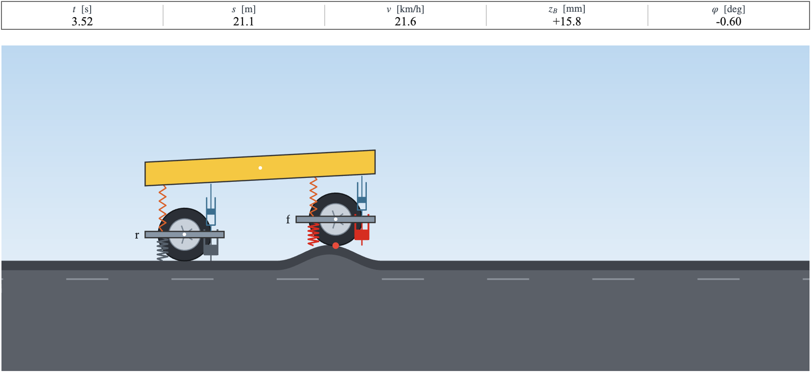
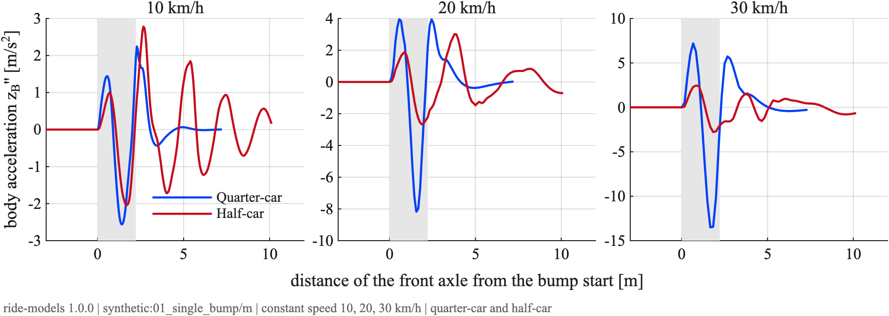
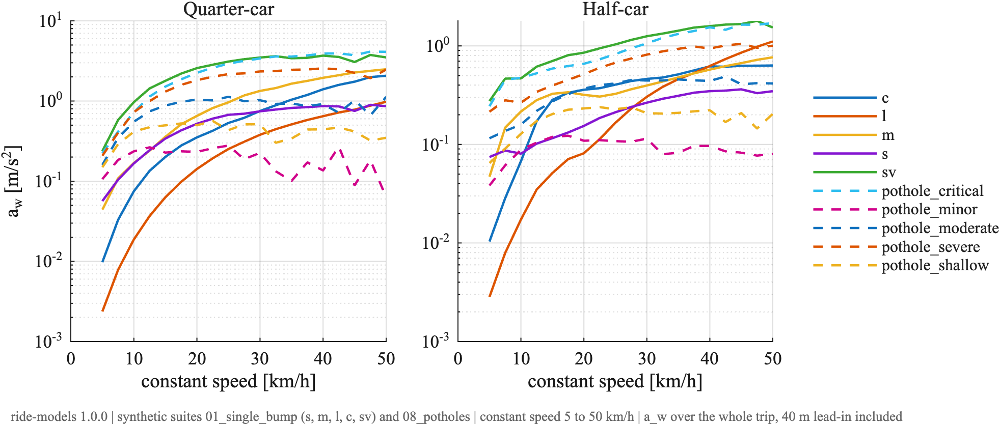

# Ride Models for MATLAB

[](LICENSE)
[](https://www.mathworks.com/products/matlab.html)
[](https://github.com/CALM-Dataset/ride-models-matlab/actions/workflows/tests.yml)
[](https://doi.org/10.5281/zenodo.23627533)

Quarter-car and half-car models for ride comfort over speed bumps, crosswalks and potholes. Give it a road and a speed profile and it simulates the vertical dynamics of the car and rates the ride with the ISO 2631-1 weighted acceleration. The same models are available as a Simulink block library. The package is the MATLAB side of the [CALM](https://huggingface.co/CALM-Dataset) project.

<p align="center">
  <br>
  <em>The half-car crossing a speed bump, from <code>ride.render.animate</code>.</em>
</p>

> [!NOTE]
> The measured roads and their comfort profiles are gated on Hugging Face. Everything else runs offline.

## This implements

- Quarter-car (6 states) and half-car (11 states, pitch and longitudinal load transfer) with nonlinear springs and dampers
- 185 synthetic road scenarios and 159 measured road profiles from [CALM-Scenarios](https://huggingface.co/datasets/CALM-Dataset/CALM-Scenarios)
- Speed profiles: constant, speed dip, ramp, rule-based driver, the MPC and PPO profiles of [CALM-Germany](https://huggingface.co/datasets/CALM-Dataset/CALM-Germany) and [CALM-Italy](https://huggingface.co/datasets/CALM-Dataset/CALM-Italy), tables and custom functions
- Metrics: weighted RMS acceleration `a_w`, vibration dose value, peak acceleration, travel time
- A Simulink library with the same models
- Registries for models, scenarios, speed profiles and metrics, so you can add your own without changing the package

## Installation

1. Download `ride-models-<version>.mltbx` from the [releases page](https://github.com/CALM-Dataset/ride-models-matlab/releases) and open it in MATLAB, or clone the repository and run `setup` in each session.
2. MATLAB R2025b. Simulink for the block library. The Signal Processing Toolbox is optional.

## Quick start

```matlab
setup
r = ride.run();
disp(r.metrics)
ride.render.animate(r.P, r.road, r.out)
```

`config/default.json` simulates the half-car over a medium speed bump with a speed reduction before it. Override any setting:

```matlab
r = ride.run(ride.config('model', 'quartercar', 'scenario', 'synthetic:02_two_bumps/s_l'));
```

<p align="center">
  <br>
  <em>Body acceleration of the two models over the same bump at three speeds.</em>
</p>

<p align="center">
  <br>
  <em>Weighted RMS acceleration against constant speed for single bumps and potholes.</em>
</p>

More examples are in `examples/` and `examples/live/`.

## Measured roads

The roads are downloaded on first use from the `germany/crossings` and `italy/crossings` folders of CALM-Scenarios into `data/cache/scenarios`. The names under `eval:` in its `split.yaml` are the evaluation roads, the name under `exclude:` is left out of training, all others are training roads.

```matlab
setenv('HF_TOKEN', 'hf_...')
ride.scenarios.real.sync('all')
ride.scenarios.real.list('eval')
r = ride.run(ride.config('scenario', 'real:stuttgart_sb01', 'drive.profile', 'mpc'));
```

The `mpc` and `ppo` profiles come from `sequences/<area>/<road>/comfort_profiles/` of CALM-Germany and CALM-Italy. They exist only for roads whose bump is not marked low confidence.

## Model accuracy

The MATLAB and Simulink implementations agree with an independent Python implementation to within 1e-11 relative to the signal peak. Against IMU measurements from 104 recorded drives, the calibrated half-car reproduces the weighted RMS acceleration to within about 85 %, with no overall bias, and 81 % of the drives are within 30 % of the measurement. Details and limits are on the [Model accuracy](https://github.com/CALM-Dataset/ride-models-matlab/wiki/Model-accuracy) page.

Run the tests with:

```matlab
setup
runtests('tests')
```

## Documentation

Reference pages in the [wiki](https://github.com/CALM-Dataset/ride-models-matlab/wiki): [Getting started](https://github.com/CALM-Dataset/ride-models-matlab/wiki/Getting-started), [Model equations](https://github.com/CALM-Dataset/ride-models-matlab/wiki/Model-equations), [Scenarios](https://github.com/CALM-Dataset/ride-models-matlab/wiki/Scenarios), [Speed profiles and metrics](https://github.com/CALM-Dataset/ride-models-matlab/wiki/Speed-profiles-and-metrics), [Simulink](https://github.com/CALM-Dataset/ride-models-matlab/wiki/Simulink), [Adding a model](https://github.com/CALM-Dataset/ride-models-matlab/wiki/Adding-a-model), [Model accuracy](https://github.com/CALM-Dataset/ride-models-matlab/wiki/Model-accuracy), [Development](https://github.com/CALM-Dataset/ride-models-matlab/wiki/Development).

## Citation

If you use this software, please cite:

> Abdelazim, M. E. S. Azab, *Comfort-Aware Speed Planning over Road Anomalies: A Reinforcement-Learning Approach*, Bachelor's thesis, Technische Universität Berlin, 2026. [doi:10.14279/depositonce-26841](https://doi.org/10.14279/depositonce-26841).

To cite the software itself, use the Zenodo archive: [doi:10.5281/zenodo.23627533](https://doi.org/10.5281/zenodo.23627533). `CITATION.cff` has a machine-readable citation.

## Acknowledgment

- [CARD](https://huggingface.co/CARD-Data) for the recordings behind the measured roads
- The [CALM](https://huggingface.co/CALM-Dataset) project, which this package belongs to

## License

Released under the [MIT License](LICENSE).
