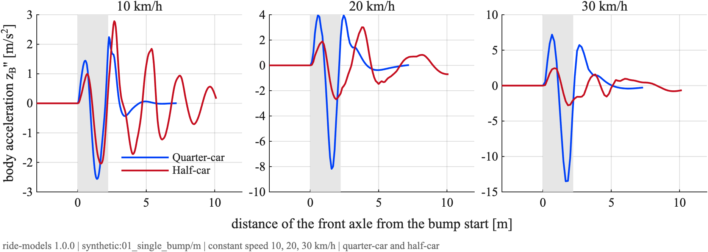
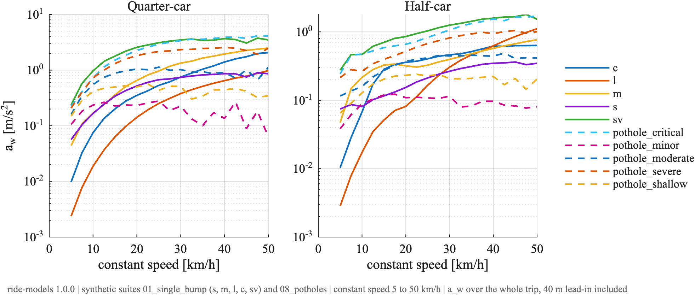

# Ride models

How much does a car shake over a speed bump, and does driving slower help? Quarter-car and half-car ride models in MATLAB and Simulink, with synthetic and measured roads, ISO 2631-1 comfort scores and an animated view.


```matlab
setup
r = ride.run();                            % half-car, medium bump, slowing down before it
disp(r.metrics)                            % a_w, vdv, peak_acc, travel_time, mean_speed
ride.render.animate(r.P, r.road, r.out)
```

## What's in it

- **Models**: quarter-car (6 states) and half-car with pitch and load transfer (11 states)
- **Roads**: 185 synthetic roads from a size-code catalog, 159 measured roads from Hugging Face, or your own
- **Speed profiles**: constant, a dip before the bump, a reactive driver, recorded MPC and human drives, ramps, tables or any function
- **Comfort**: ISO 2631-1 weighted RMS `a_w`, VDV, peaks, trip time, pitch and suspension travel
- **Simulink**: a block library with the same two models

Models, roads, profiles and metrics are all plug-ins. A new model is one folder; a new road, profile or metric is one function.

## Examples

The two models over the same bump at three speeds:



Slower is not always more comfortable. Over the shallow and minor potholes `a_w` peaks at a middle speed:



Pick another car, road or speed profile:

```matlab
r = ride.run(ride.config('model', 'quartercar', 'scenario', 'synthetic:02_two_bumps/s_l'));
```

Add your own road and metric:

```matlab
ride.scenarios.register('washboard', @() ride.scenarios.make('washboard', ...
    ride.core.terrain.from_function(@(s) 0.03 * sin(2 * pi * s / 5), 60, 0.02)));
ride.metrics.register('peak_wheel_acc', @(out, P, sc) max(abs(out.z_W_ddot)));
r = ride.run(ride.config('scenario', 'registered:washboard', 'metrics', {'a_w', 'peak_wheel_acc'}));
```

More in `examples/`, `examples/live/getting_started.mlx` and the [wiki](https://github.com/CALM-Dataset/ride-models-matlab/wiki).

## How good is it

The MATLAB code and the Simulink blocks match an independent Python implementation to within about 1e-11 of the signal peak. Against the IMU of the real car on 105 recorded drives, the calibrated half-car's `a_w` is within 16 % at the median, with no real bias. Details and limits are on the [Validation](https://github.com/CALM-Dataset/ride-models-matlab/wiki/Validation) page.

## Install

Download `ride-models-<version>.mltbx` from the [releases](https://github.com/CALM-Dataset/ride-models-matlab/releases) and double-click it in MATLAB. Or clone the repository and run `setup` once per session.

Needs MATLAB R2025b. Simulink is only needed for the blocks. The Signal Processing Toolbox is used by the Wk filter if installed. The measured roads need access to the private Hugging Face dataset `CALM-Dataset/CALM-Scenarios`; everything else works offline.

## Tests

```matlab
setup
runtests('tests')
```

## Cite

If you use this package, cite the thesis it was written for:

> Mohammed El Said Azab Abdelazim. *Comfort-Aware Speed Planning over Road Anomalies: A Reinforcement-Learning Approach.* Bachelor's thesis, Technische Universität Berlin, 2026.

`CITATION.cff` has the same entry, and GitHub shows it under "Cite this repository".

## Licence

MIT
