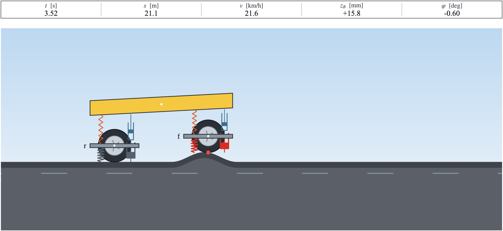

# Ride models

How much does a car shake over a speed bump, and does driving slower help? Quarter-car and half-car models in MATLAB and Simulink, with real and synthetic roads, comfort scores and an animated view.



```matlab
setup
r = ride.run();                            % half-car, a medium bump, a dip in speed before it
disp(r.metrics)                            % a_w, vdv, peak_acc, travel_time, mean_speed
ride.render.animate(r.P, r.road, r.out)
```

New here: [getting started](docs/getting-started.md), or open `examples/live/getting_started.mlx`.

## What is in it

| | |
| --- | --- |
| **Models** | quarter-car (6 states) and half-car with pitch and load transfer (11 states) |
| **Scenarios** | 185 synthetic roads from a size-code catalog, 159 measured roads from Hugging Face, your own files or functions |
| **Speed profiles** | constant, reactive driver, recorded MPC and human drives, dip before the bump, ramp, table, or any function |
| **Metrics** | ISO 2631-1 weighted RMS `a_w`, `vdv`, peaks, trip time, pitch and suspension travel |
| **Views** | animated scene with charts, one-frame export, video |
| **Simulink** | a block library with the same two models, checked against the same reference runs |

Everything is a plug-in. A new model is one folder, and a new scenario, speed profile or metric is one function; the whole tool works with it.

## Pick what to run

All in `config/default.json`, or as overrides:

```matlab
r = ride.run(ride.config('model', 'quartercar', 'scenario', 'synthetic:02_two_bumps/s_l'));
r = ride.run(ride.config('scenario', 'real:germany/eval/stuttgart_sb01'));   % needs HF_TOKEN, see the scenarios guide
```

## Add your own

```matlab
ride.scenarios.register('washboard', @() ride.scenarios.make('washboard', ...
    ride.core.terrain.from_function(@(s) 0.03 * sin(2 * pi * s / 5), 60, 0.02)));
ride.metrics.register('peak_wheel_acc', @(out, P, sc) max(abs(out.z_W_ddot)));
r = ride.run(ride.config('model', 'quartercar', 'scenario', 'registered:washboard', 'metrics', {'a_w', 'peak_wheel_acc'}));
```

Worked examples are in `examples/extend`, and `templates/model` is a model to copy.

## Guides

| | |
| --- | --- |
| [Getting started](docs/getting-started.md) | install, first run, what a simulation returns |
| [Concepts](docs/concepts.md) | models, comfort, symbols, units |
| [Scenarios](docs/scenarios.md) | synthetic names, Hugging Face roads, your own roads |
| [Profiles and metrics](docs/profiles-and-metrics.md) | built-ins and how to add one |
| [Adding a model](docs/add-a-model.md) | the folder contract, the template and the check |
| [Simulink](docs/simulink.md) | the block library and the demo models |
| [Model equations](docs/model-equations.md) | equations, parameters and comfort measures |
| [Validation](docs/validation.md) | what is tested and the limits of the models |
| [Against the recorded car](docs/validation-real-data.md) | simulation against the IMU of 105 recorded drives |
| [Figures](docs/figures.md) | every figure and the script that draws it |
| [Development](docs/development.md) | tests, CI, generated files |
| [Packaging](docs/packaging.md) and [releasing](docs/releasing.md) | toolbox file, release steps |

## Tests

```matlab
setup
run('tests/run_tests.m')
```

The models are replayed against reference runs from an independent implementation of the same equations, and the Simulink blocks against the same runs. Against the car's IMU on 105 measured drives, the calibrated half-car's `a_w` is within 16 % at the median; see [validation](docs/validation.md) and [the recorded drives](docs/validation-real-data.md). The scenario, profile, metric and model layers are checked on invariants, not stored numbers. `runtests('tests')` runs everything, Simulink included.

## Layout

```
setup.m  VERSION  config/default.json
src/+ride
├── run  config  load  simulate  root  version
├── +core         terrain  comfort  suspension
├── +models       halfcar  quartercar  (+ list get register validate)
├── +scenarios    synthetic  real  (+ get list register make from_file)
├── +profiles     builtin  library  (+ speeds list register)
├── +metrics      builtin  (+ evaluate list register)
├── +render       scene  plots  (+ animate frame_figure)
└── +validation   recordings, roads and the comparison with the IMU
simulink   ride_lib.slx and the scripts that build and test it
data/models  data/scenarios  docs  examples  templates  tests  toolbox
```

## Requirements

MATLAB R2025b, the release this version was tested on; older releases are not tested. Simulink for the Simulink blocks. The Signal Processing Toolbox `resample` is used inside the Wk filter when it is installed; without it the filter upsamples with `pchip`, which changes `a_w` slightly. Octave is not supported.

## How to cite

If you use this package, cite the thesis it was written for:

> Mohammed El Said Azab Abdelazim. *Comfort-Aware Speed Planning over Road Anomalies: A Reinforcement-Learning Approach.* Bachelor's thesis, Technische Universität Berlin, 2026.

`CITATION.cff` has the same entry in machine-readable form, and GitHub shows it under "Cite this repository".

## Licence

MIT
