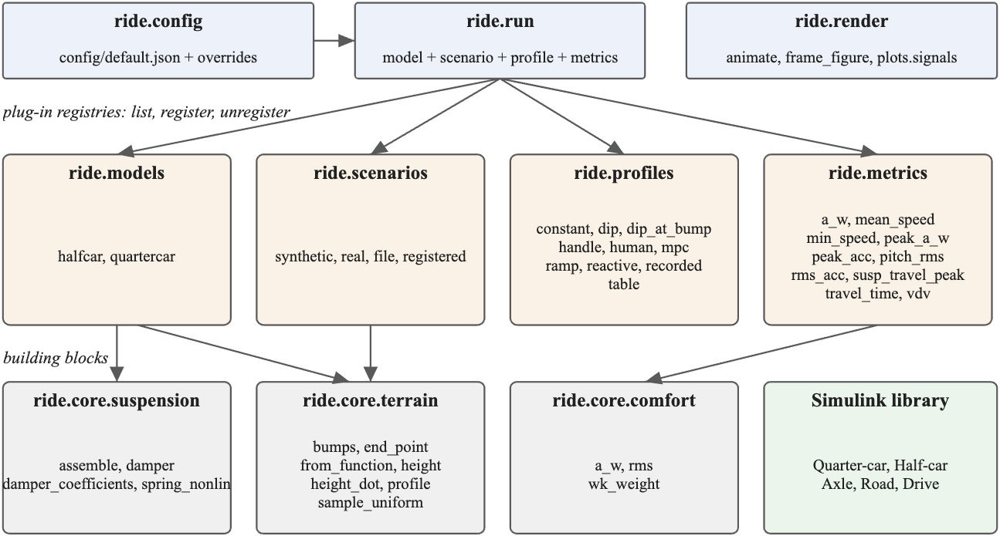

# Ride models: a MATLAB and Simulink package for ride comfort over road anomalies

Mohammed El Said Azab Abdelazim

## Purpose

Speed bumps, raised crosswalks and potholes shake a car's body, and the driver's choice of speed changes how much. Studying that trade-off, for example to plan comfortable speeds, needs three things that are usually written anew for every study: a vehicle model that responds to the road, a set of roads to test on, and a comfort measure. This package provides the three in one place, in a form that can be extended without editing it. It was written for the thesis *Comfort-Aware Speed Planning over Road Anomalies: A Reinforcement-Learning Approach* (Technische Universität Berlin, 2026) and is usable on its own.

A run takes a vehicle model, a road scenario, a speed profile and a list of metrics, and returns the simulated signals and the scores:

```matlab
r = ride.run(ride.config('model', 'halfcar', 'scenario', 'synthetic:m', 'drive.profile', 'reactive'));
r.metrics.a_w        % ISO 2631-1 weighted RMS body acceleration, m/s^2
```

## Architecture



The package is a MATLAB namespace, `ride`. `ride.config` reads the settings from a JSON file and applies overrides; `ride.run` loads the model parameters, builds the scenario, computes the speed at every 20 ms step, simulates and evaluates the metrics. `ride.render` draws the result as an animated scene above time-series charts. The building blocks in `ride.core` are shared: road geometry (`terrain`), the nonlinear spring and damper (`suspension`), and the ISO 2631-1 weighting (`comfort`). A Simulink library holds the same two vehicle models as block diagrams.

## Plug-in points

Each of the four inputs to a run is a registry with the same interface: `list`, `register` and `unregister`, plus a lookup.

- **Models.** A model is a folder `+ride/+models/+<name>` with an `info.m` that points to its parameter loader, simulation function and drawing functions. Folders on the MATLAB path are discovered, so adding a model needs no change to the package. `ride.models.validate` checks a model against the contract. The package ships a quarter-car (heave, 6 states) and a half-car (heave and pitch with load transfer from longitudinal acceleration, 11 states), and a template model to copy.
- **Scenarios.** A road is a list of raised-cosine bumps and holes or a measured height profile. Built in are 185 synthetic roads named by size codes (`s_hm_c`: a short bump, a medium hole, a raised crosswalk) and a loader for 159 measured roads from a Hugging Face dataset, trimmed to the labelled feature. Roads can also come from JSON files, functions of distance, or any registered factory.
- **Speed profiles.** A profile turns the scenario into one speed per step: constant, a Gaussian dip before the first feature, a ramp, interpolated points, any function of time, a deterministic rule-based driver that brakes before steep features, or recorded drives.
- **Metrics.** A metric is a function of the simulated signals, the parameters and the scenario. Built in are the Wk-weighted RMS `a_w`, the unweighted RMS, the vibration dose value, peaks, pitch, suspension travel, trip time and speeds; all stop at the end of the road.

## Numerical method and validation

Both models are integrated with the classical fourth-order Runge-Kutta method at 1 ms inside each 20 ms output step, with the road height rate under each wheel as input; [model-equations.md](model-equations.md) gives the equations as implemented. The MATLAB simulation reproduces six reference drives from an independent Python implementation of the same equations to about 1e-15 relative to the signal peak for the accelerations and 2e-13 for `a_w`, and the Simulink blocks reproduce them to within 1e-11. The analog Wk design is within 0.01 dB of the tabulated ISO 2631-1 weighting at 1, 4, 6.3 and 8 Hz, and the tests check the implementation within 0.1 dB. Replaying the 1012 speed profiles of the CALM comfort study through the half-car reproduces the study's `a_w` to a median relative difference of 9e-5 (largest 0.3 %). Against the IMU of 105 recorded drives on measured roads, the calibrated half-car's `a_w` is within 16 % of the measurement at the median, without systematic bias, and the held-out roads do no worse; the quarter-car overestimates it by about half. The other tests check invariants of the scenario, profile, metric and registry layers instead of stored numbers. [validation.md](validation.md) lists the checks and the limits, and [validation-real-data.md](validation-real-data.md) the comparison with the recorded drives.

## Example use

The scripts in `examples/paper` reproduce four figures, and `replay_calm_profiles.m` the replay of the CALM comfort study, given its export folder. One compares the body acceleration of the two models over the same bump. One sweeps the constant speed over the single-feature roads of the catalog: over the bumps, `a_w` mostly grows with speed, while over the shallow and minor potholes it peaks at an intermediate speed and falls again, so slower is not always more comfortable. One compares three speed profiles on four roads. One plots the reference comparison. Each figure carries the package version, the scenarios and the profiles it was made with.

## Limitations

The models are planar, with no roll, seat or occupant, and a tyre that stays in contact. There is one parameter set, from the thesis project. The output signals and therefore `a_w` are sampled at 50 Hz. `a_w` is averaged over the whole trip, so it depends on the amount of level road in the scenario. Measured roads are interpolated linearly between samples 5 cm apart. The package was tested on MATLAB R2025b only.

## Availability

Source code under the MIT licence at https://github.com/CALM-Dataset/ride-models-matlab, as a MATLAB toolbox file built from the repository, and with a citation entry in `CITATION.cff`. The measured roads are in the Hugging Face dataset `CALM-Dataset/CALM-Scenarios`, which is private and needs an access token. Requirements: MATLAB (tested on R2025b); Simulink for the block library; the Signal Processing Toolbox is used by the Wk filter when installed.
